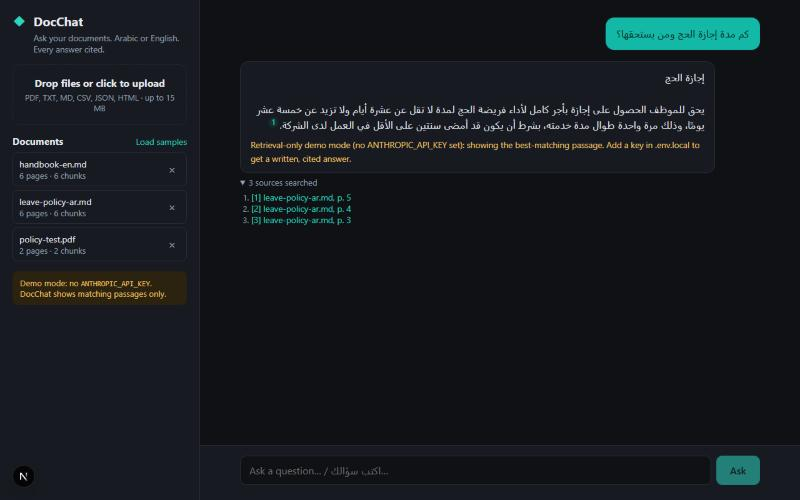

# DocChat: chat with your documents, in Arabic or English

Upload PDFs or text files, ask questions in Arabic or English, and get answers that
**cite the exact passage and page** they came from. Built for businesses that need
answers grounded in their own policies, contracts, manuals or knowledge base,
not the model's general knowledge.



## Features

- **Retrieval-augmented generation (RAG):** documents are chunked and indexed, and only the most relevant passages go to the model
- **Grounded citations:** uses Claude's native citations, so every claim links back to its source passage and page, and clicking a citation shows the passage
- **Arabic + English:** Arabic-aware search that normalizes letter variants (أ/إ/آ → ا, ة → ه, ى → ي), strips diacritics and the definite article; replies come in the user's language with automatic right-to-left layout
- **Streaming answers** over NDJSON
- **Says "I don't know":** when the documents don't cover a question, it says so instead of guessing
- **PDF, TXT, Markdown, CSV, JSON and HTML** uploads, with page numbers kept for PDFs
- **Works without an API key:** retrieval-only demo mode shows the best-matching passage

## Stack

Next.js 16 (App Router) · React 19 · TypeScript · Anthropic Claude API (`@anthropic-ai/sdk`) · `unpdf`.
Search is a dependency-free BM25 index; swap in a vector database (pgvector, Qdrant)
for large collections.

## Run it

```bash
npm install
cp .env.example .env.local   # then add your ANTHROPIC_API_KEY
npm run dev                  # http://localhost:3000
```

Click **Load samples** to try it with a sample English handbook and an Arabic leave policy.

```bash
npm test          # retrieval and Arabic-normalization tests
npm run build     # production build with type checking
```

## How it works

1. **Ingest** (`lib/parse.ts`, `lib/chunk.ts`): extract text per page and split it into ~900-character overlapping chunks on sentence boundaries.
2. **Index** (`lib/bm25.ts`, `lib/text.ts`): tokenize with Arabic normalization and score with Okapi BM25.
3. **Retrieve** (`lib/answer.ts`): take the top passages and drop weak matches (below 25% of the best score).
4. **Answer:** send the passages to Claude as `document` blocks with citations enabled, stream the reply, and map citations back to passages.

## Production notes

The in-memory store resets on restart. For production, persist documents and chunks
(Postgres + pgvector, or a managed vector DB), add authentication, and put each
customer's documents in their own namespace.

## License

MIT
